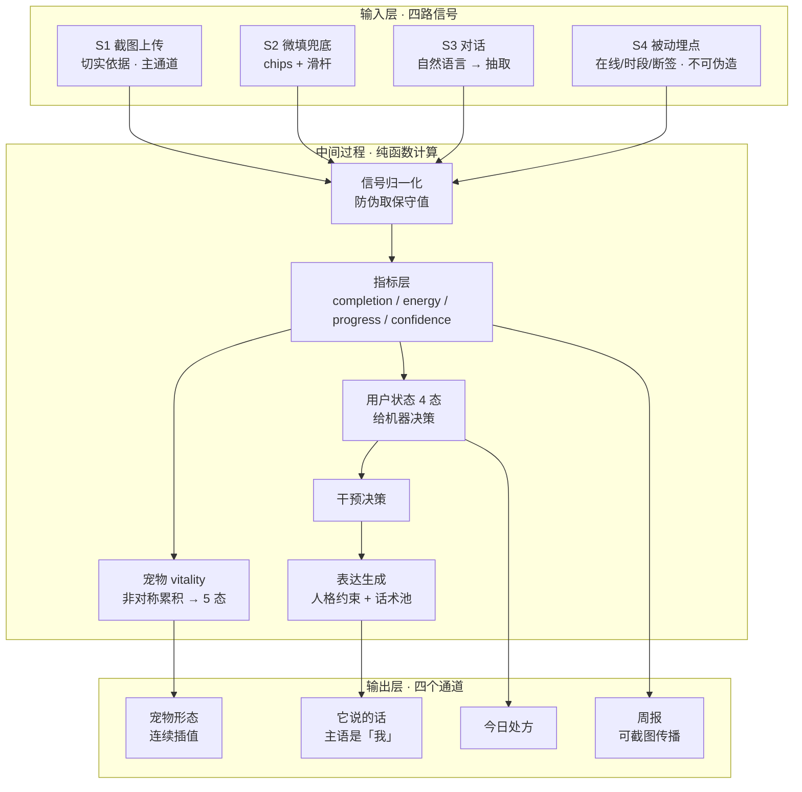
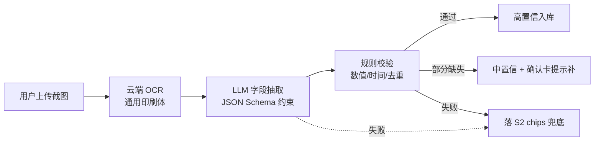

# 考公陪跑 Agent · 完整方案

> ⚠️ **定位已修正（2026-10-30 23:00）**：产品本质是**督学工具**，情绪陪伴与长期记忆是亮点。本文档中与「不做督学 / 只做陪伴」相关的表述已过时，**以 `考公陪跑Agent_PRD_v1.1.md` 为准**。架构、机制、成本、不做清单等其余内容仍然有效。


> 版本 v1.0 · 2026-10-30 · 承接《用户/商业/可行性分析》《功能需求与原型》《电子宠物机制》三份文档，整合为单一主文档。
>
> **本版关键变更**：输入端第一原则确定为——**以用户截图上传为切实依据**，自主填报降级为兜底手段。

---

## 00 项目定位

### 0.1 一句话定义

一个能同时"看见"很多人的 agent，要让每一个人都觉得**它只看见了我**。

它不卖课、不押题、不承诺上岸。只做一件事：**在备考的 180 天里，每天知道你今天是什么状态，并且在该让你停的时候让你停。**

### 0.2 四条设计铁律（所有功能都要过这道闸）

1. **不做内容供给。** 凡是"讲知识点""出押题卷""给解题技巧"的需求，一律砍掉。
2. **状态必须被推断，不能被陈述。** 用户说"我难受"才反应，那叫客服；从行为信号里先发现，才叫 agent。
3. **敢反着用户的期待说话。** "加油"是垃圾，"今天别学了，去睡"是产品。人格不是装饰层，是核心功能。
4. **记忆是唯一的复购理由。** 换一个 AI 就要重新解释一遍自己——只要这件事足够痛，用户就不会走。

### 0.3 核心卖点：一个飞轮，不是两个卖点

产品只有两个核心卖点，但它们**不是并列关系，而是同一个飞轮的两半**：

```
宠物做得好 → 用户愿意多说/多传 → 记忆更丰富
     ↑                               ↓
     └────── 宠物更懂他 ← 记忆更准 ──┘
```

- **没有宠物**：记忆是个冷冰冰的数据库，用户不会为它留下
- **没有记忆**：宠物是张贴纸，三天就腻
- 反向同样成立：宠物做砸 → 用户不传了 → 记忆枯竭 → 宠物更空洞 → 卸载

**两个卖点必须同时成立，缺一个就崩。**

#### 卖点 1：宠物陪伴的情绪价值

情绪价值 ≠ 安慰。区别在于：

| ✕ 安慰 | ✓ 被理解 |
|---|---|
| 你说难受，它说"别难过" | **你没说，它先发现"你今天不太一样"** |
| 靠话术 | 靠推断 |

因此卖点 1 的技术支撑是**推断准确度**。**判定一致率 ≥ 70% 不是加分项，是生死线。** 情绪价值来自累积而非单次体验，所以冷启动的前 7 天是生死期。

#### 卖点 2：历史记录作为长期记忆

记忆有三层，只有第三层值钱：

| 层 | 记忆内容 | 用户感受 | 是否护城河 |
|---|---|---|---|
| L1 事实 | 考什么岗、目标分 | "我填过" | ❌ 换个产品重填一次就行 |
| L2 模式 | 你凌晨效率低、周四人最崩 | "它好像注意到了" | ⚠️ 需数据积累，可复制 |
| **L3 预判** | **在你要崩的那天提前拦住你** | **"它比我先知道"** | ✅ **真壁垒** |

绝大多数产品停在 L1，少数到 L2。**L3 才是"贴合用户行为"的真正含义——不是记住你，是在你之前。**

#### 关键洞察：记忆是慢的，宠物负责撑过空窗期

```
用户耐心    ────●━━━━━━━━━━━━━━━━━━━━━━  （线性，第一周最高）
记忆能力    ──●───────────────────────   （指数，第 4–6 周才起来）
            ↑
        这里有个空窗期
```

用户的期待是线性的，记忆的实际能力是指数的。**前 3 周没有任何"被记住"的东西可兑现**，这时候靠什么留人？只有宠物。

产品节奏：**宠物先上，记忆后补，两者在第 4 周合流。**（详见 06.4）

#### 壁垒在哪

不在宠物形象（能抄），不在记忆架构（能抄），而在：

> **这个用户和这个产品之间那段私有的、无法迁移的历史。**

宠物形态记录了他的 180 天，记忆里存着他说过的话。换一个产品，宠物要从头养，自己要从头解释一遍。这个成本才是唯一抄不走的东西。

### 0.4 输入第一原则（本版新增）：截图为据

**用户的学习数据，以用户自己上传的学习截图为切实依据。**

这条原则解决的是"产品使用不佳"的最大风险源：如果依赖用户自主填报，数据既不准也不可信，宠物状态失真，"一致性感知"直接失效。

- 截图 = **客观证据**，摩擦低（学习博主本来就在截图）、可信度高（带时间戳、难造假）
- 自主填报 = **兜底手段**，只在截图失败时出现，且标记低置信
- 被动埋点 = **锚**，不可伪造，永远在场

（详见 03 章）

---

## 01 用户与商业（承接原报告）

### 1.1 四层用户，付费意愿完全相反

| 人群 | 占比估算 | 核心痛点 | 付费意愿 | 对我们的价值 |
|---|---|---|---|---|
| 应届生 | 约 45% | 有同伴、有图书馆、有时间，焦虑但热闹 | 低 ¥30–80/月 | 传播力最强，是最好的冷启动渠道 |
| 在职备考 | 约 35% | 时间碎、无人监督、不敢让同事知道 | **高 ¥99–299/月** | **核心付费人群** |
| 二战/大龄 | 约 20% | 沉没成本、羞耻感、同辈压力、经济压力 | 最高 ¥300–1000 | 情绪价值最买单，也是退款投诉风险最高 |
| 家长代付 | — | 仅应届生群体存在，弱于高考家长 | 中 | 不作为主路径 |

**政策趋势**：2026 国考普通岗位年龄上限放宽到 38 岁、应届硕博 43 岁——"大龄、在职、有家庭负担"的考生占比在结构性上升，恰好是最痛、最愿意付钱、最缺人陪的一群。

### 1.2 情绪曲线与五个没人接住的时刻

备考 180 天的情绪从报名亢奋逐步下滑，四个低谷：首次模考（分数不涨反跌）→ 考前 30 天（失眠焦虑峰值）→ 考后当晚（突然空掉）→ 出分日（最低点）。

> **整个行业只服务「考前」，没有一个人服务「考后」。** 出分那天所有机构撤退、所有群解散——而这恰好是用户情绪最低点、也是他决定要不要二战的时刻。**复购决策发生的地方，竞品全部缺席。**

### 1.3 需求已被验证，只是供给粗糙

淘宝"考公监督服务"（加微信、每天催打卡，几块钱一天，纯人工）的存在说明：付费意愿是真实的，现有供给没有产品化。专业替代品（心理咨询 300–800 元/次）太贵。中间那一段——**"我想有人管我，但不想花咨询的钱，也不想被朋友看见我这么狼狈"**——是空白。

### 1.4 商业结论

| 指标 | 2025 实际 | 含义 |
|---|---|---|
| 粉笔营收 | 26.77 亿（−4.1%） | 连续两年负增长 |
| 传统大班课付费人次 | 120 万 → 90 万（−30%） | **最便宜的课，死得最快** |
| 考公小班课收入 | 17.38 亿，占比 60%→65% | **贵的、重服务的，在涨** |
| 参培渗透率 | 约 30% | 70% 的人没被服务过 |
| 2021 协议班退款率 | 73% | 承诺效果的代价 |

三条结论：

1. **不要做"又一个卖课的"。** 低价内容竞争已打成白菜价。
2. **钱在「重服务」那一侧。** 用户不为录播课花钱，为"有人管我"花钱。
3. **重服务的人力成本压不住**——这正是 agent 存在的理由：把"一对一"的边际成本打到接近零。

### 1.5 产品分层与定价

| 档位 | 价格 | 交付物（可感知的） | 目标人群 |
|---|---|---|---|
| 自习室 | 免费 | 每日学习记录 + 每周状态报告 | 引流，靠报告截图传播 |
| 陪跑 | ¥99/月 | 每日状态判断 + 主动干预 + 一个考季的完整记忆 | 主力，在职考生 |
| 冲刺 | ¥399/考前30天 | 高频触达 + 作息干预 + 考前 48h 守夜 | 焦虑峰值，转化率最高 |
| 二战 | ¥699/考季 | 失败复盘 + 重建计划 + 出分日当晚陪伴 | 情绪最重，LTV 最高 |

### 1.6 单位经济（估算，需访谈校准）

| 项目 | 量级 | 说明 |
|---|---|---|
| 客单价 | ¥99/月 × 3–5 个月 | 一个考季 ¥300–500，冲刺档拉到 ¥700+ |
| 获客成本 | ¥30–80 | 内容驱动，非投放 |
| AI 成本 | ¥10–30 / 考季 | 对话 + 每日状态推断 + OCR（见 09.4） |
| 毛利 | 85%+ | 相对小班课最大的结构性优势 |
| 复购 | 35–45% | 国考→省考→事业单位，天然多考季 |
| LTV | ¥450–700 | LTV/CAC ≈ 8–15 |

### 1.7 必须避开的三个坑

1. **不承诺效果。** 永远不说"提高上岸率"，只说"陪你走完这 180 天"。
2. **不把失败归因于产品。** 98:1 是常态，产品第一天就要把预期说清楚。
3. **不单平台获客。** 学习记录必须是用户可导出的资产，带得走。

---

## 02 系统架构

### 2.1 四层一底座



底座：**记忆核（Memory Core）**——L0 档案 / L1 承诺 / L2 事件 / L3 策略 / L4 摘要。唯一跨模块共享的资产。

**关键取舍**：推断层明确不用大模型（快、稳、可解释、零成本）。大模型只出现在两处：表达层（把判定翻译成人话）、截图字段抽取（OCR 文本 → 结构化 JSON）。

### 2.2 一天的数据流走查

```
22:40  用户传一张粉笔练习报告截图（今天做的 40 题）
       → OCR 抽取：模块=资料分析+判断推理，题量 40，正确率 72%，时间 22:35
       → 校验通过（时间差 5 分钟，hash 未重复）→ confidence = 0.9
       → 弹出确认卡：用户点「没问题」（修正成本 = 1 次点击）

       completion = (62/60)×0.6 + 0.72×0.4 ≈ 0.91
       energy = 66（22:35 尚可，非深夜）
       progress = 58（正确率较上周 +3）
       confidence = 0.88

     ├→ 用户状态：稳（不进干预流程）
     └→ vitality = 0.60×70 + 0.40×91 = 78.4 → 「元气」（首次突破 78）

输出：宠物叶片明显上扬 + 头顶开花（第一次）
      「嗯，今天挺好。我这叶子好像硬了一点。」
```

---

## 03 输入端设计（本版重点）

### 3.1 设计原则

1. **截图为据。** 用户上传自己学习过程产生的截图，作为完成度判定的主要证据。
2. **填报为辅。** 自主填报只在截图失败/缺失时兜底，且置信度低。
3. **被动信号是锚。** 无论用户填什么，系统自己看到的（在线时段、断签）永远在场，冲突时取保守值。
4. **确认代替录入。** OCR 识别后让用户"确认/修正一次"，而不是从零填写——把认知负荷从"填"降到"核对"。
5. **别叫它打卡。** 按钮文案用「贴一张今天的学习截图」「今天到这儿」，不用「打卡」二字（打卡自带表演属性）。

### 3.2 四路信号体系

| 路 | 通道 | 拿到什么 | 置信度 | 角色 |
|---|---|---|---|---|
| **S1 截图上传** | 用户拍照/选图 → OCR → 确认 | 模块、题量、正确率、时长、时间 | **高（0.85–0.95）** | **主通道，切实依据** |
| S2 微填兜底 | chips 多选 + 滑杆 | 模块档位、题量档位、主观感受 | 低（0.5–0.6） | OCR 失败/不便截图时兜底 |
| S3 对话 | 一句话 | 细节 + 情绪信号 | 中（0.6–0.7） | 自然补充 + 情绪数据源 |
| S4 被动埋点 | 系统自动 | 开/关时间、在线时长、切后台次数、深夜活跃、断签 | **不可伪造** | 永远在场的锚 |

**权重关系：S4 ≥ S1 > S3 > S2。** 冲突时取保守值（见 3.8）。

### 3.3 截图上传的交互设计

```
首屏主按钮（大）：📷 贴一张今天的学习截图
  ├ 支持相册选取 or 直接拍照
  ├ 支持一次选 1–5 张（批量）
  └ 传后 ≤ 2 秒返回「识别确认卡」

识别确认卡：
  ┌─────────────────────────────┐
  │ 我看到的是：                  │
  │  模块：资料分析 · 判断推理      │
  │  题量：40 题 · 正确率 72%      │
  │  时间：今天 22:35             │
  │  [ 没问题 ✓ ]   [ 改一下 ]    │
  └─────────────────────────────┘
```

要点：

- **确认卡必须有人工确认步骤**。这一步同时解决三件事：兜住 OCR 识别错误、给用户掌控感、教育用户"它看的是截图"。
- 「改一下」进入修正模式：逐字段点选修改，不要求重新打字。
- 识别失败时直接落到 S2 chips 兜底，不要让用户卡在"重试"上。
- 冷启动时用引导页教用户**截什么**（见 3.4）。

### 3.4 截什么图：三类来源（写进引导页）

| 类型 | 例子 | 能抽到什么 |
|---|---|---|
| 刷题 App 报告页 | 粉笔/华图/步知的练习报告、成绩页 | 模块、题量、正确率、时间 |
| 计时 App 统计页 | 番茄 ToDo、Forest 的今日统计 | 时长、时段 |
| 其他学习凭证 | 网课进度页、笔记页、错题本页 | 完成事实（粗粒度） |

MVP 只承诺前两类，第三类识别出来就记、识别不出来就只存原图不入指标。

### 3.5 OCR → 结构化管线

**推荐技术路线：云端通用 OCR + LLM 字段抽取 + 规则校验。**

不同题库 App 界面格式差异大，纯规则模板维护成本极高；LLM 抽取 + 规则校验的组合最务实：OCR 负责把图变成文本，LLM 负责从乱糟糟的文本里挑字段，规则负责兜住 LLM 的错误。



**抽取目标 Schema：**

```json
{
  "source_app": "fenbi | tomato | unknown | null",
  "event_date": "2026-10-30",
  "event_time": "22:35",
  "duration_minutes": 62,
  "modules": [
    {"name": "资料分析", "questions": 20, "correct": 15},
    {"name": "判断推理", "questions": 20, "correct": 14}
  ],
  "total_questions": 40,
  "accuracy": 0.72,
  "ocr_confidence": 0.88,
  "warnings": []
}
```

**规则校验（四条，全部自动执行）：**

1. **时间一致性**：截图内识别出的时间 vs 上传时间，差值 ≤ 36h（允许补传昨天的），超差 → 降级为"仅存档不计分"
2. **数值合理性**：0 ≤ accuracy ≤ 1；单图题量 ≤ 500；duration ≤ 16h。越界字段丢弃
3. **hash 去重**：同一张图（感知 hash）不能重复计分，重复 → 提示"这张已经记过了"
4. **模块名归一**：模糊匹配（"资料分析/资分/资料"→ 资料分析），匹配不上就保留原文并标低置信

**OCR 选型**：腾讯云通用印刷体 OCR（或微信服务市场 OCR）。免费额度通常够 MVP 用；超出后约 ¥0.001–0.002/次，每天 2–5 张，一个考季成本 < ¥2，可忽略。

### 3.6 置信度加权与完成度计算

**单图置信度** = f(OCR 置信度, 校验通过项数, 字段完整率, source_app 是否已知)

**当日综合置信度** = 各来源按加权合成：

```
confidence_today = max( S1_conf × 1.0,   # 截图
                        S2_conf × 0.6,   # 微填
                        S3_conf × 0.7 )  # 对话
若当日存在 S4 被动信号 → 保底 0.4
```

**完成度**（驱动宠物的核心指标）：

```
completion = (有效分钟 / 目标分钟) × 0.6 + 任务完成率 × 0.4

有效分钟 优先取截图证据（计时类截图直接给出）；
无计时证据时，用刷题量 × 历史单题耗时 估算；
仍无证据时，降级用 S4 在线时长 × 1.2 封顶。
```

### 3.7 防伪设计：不阻止欺骗，让欺骗无效

| 措施 | 机制 |
|---|---|
| **截图为主** | 伪造一张带时间戳、数据自洽的成绩截图的成本，远高于随手虚填 |
| 时间一致性校验 | 补传旧图、篡改时间会被自动降级 |
| hash 去重 | 同一张图反复上传无效 |
| S4 锚定 | `有效分钟 = min(证据分钟, 在线分钟 × 1.2)`，虚报被静默取保守值 |
| 无喂养收益 | 宠物没有饥饿度/体力条，充值不能让它变好——虚报没有即时回报 |

**关键姿态：不戳穿。** 用户填了 8 小时但证据只有 62 分钟，系统按 62 分钟算，宠物表现"一般"，不解释、不提示。用户自己会发现"骗它没用"——而"它不看我说什么，只看我做什么"恰恰是"被看见"的最强体验。

**⚠️ 防伪力度与产品定位的张力**：目标是"足够真实到能产生被看见的感觉"，不是 100% 真实。摄像头、屏幕监控、强制验证会直接违背"不需要监考"的定位——**过度防伪会杀死产品。**

### 3.8 边界与诚实声明

- MVP 只承诺识别 **2–3 个主流 App**（粉笔 + 番茄 ToDo）+ 通用数字抽取；其他 App 靠通用规则，识别不出来就降级，**不硬猜**
- OCR 认不准的字段让它失败降级，绝不猜测填入
- 截图依然可以被改图造假——但配合时间校验与 hash 去重，成本已足够高；本产品的防伪目标定位是"够用"而非"绝对"
- 引导页必须明确说：**"我看的是你的截图，不是你填的数字"**——这既是产品说明，也是人格声明

---

## 04 状态推断引擎

### 4.1 双轴四象限

- **能量轴 Energy**：这个人现在还有多少油。由作息规律性、深夜占比、情绪文本、断签驱动。
- **进展轴 Progress**：学了有没有用。由正确率趋势、连续错题、单位效率驱动。

| | 进展升/平 | 进展降 |
|---|---|---|
| **能量高** | 稳 | 平台期 |
| **能量低** | 过载 | 崩溃前兆 |

**「过载」是最值钱的判定**：能量低但进展在涨的人，自己觉得状态很好，所有竞品都在这里加码推课，只有你会让他停下来。这一个判定就是产品的记忆点。

### 4.2 信号 → 打分（可直接落地）

| 变量 | 定义 | 影响轴 |
|---|---|---|
| `E_over` | 超出个人基线 1.5σ 的日学习时长 | 能量 ↓ |
| `N_night` | 23:30 后时长占比 | 能量 ↓ |
| `R_std` | 近 7 日"开始学习时刻"标准差 | 能量 ↓ |
| `T_mood` | 文本情绪分（−1~+1） | 能量 ↓ |
| `G_gap` | 连续断签天数 | 双轴 ↓↓ |
| `A_acc` | 7 日正确率 − 前 7 日正确率 | 进展 ↑ |
| `C_streak` | 最大连续错题数 | 进展 ↓ |
| `P_eff` | 正确率/单题耗时 的 7 日趋势 | 进展 ↑ |

```
energy   = 100 − 18·E_over − 22·N_night − 12·R_std − 15·(1−T_mood)/2 − 20·G_gap
progress =  50 + 30·A_acc − 14·C_streak + 20·P_eff − 18·G_gap

if energy < 40 && progress < 45  → 崩溃前兆
if energy < 40 && progress ≥ 45  → 过载
if energy ≥ 40 && progress < 45  → 平台期
else                             → 稳

confidence = f(有效天数, 字段完整率, 信号一致性)
防抖：状态需连续 ≥2 天 且 confidence ≥ .6 才允许触发干预
```

权重为初始值，需用 3–5 个真实用户的 30 天数据回归校准；阈值同理。**非对称与错位的方向不可改。**

### 4.3 ⚠️ 两套状态："错位"是设计，不是 bug

| | 用户状态（4 态） | 宠物形态（5 态） |
|---|---|---|
| 依据 | 当日信号 | 历史累积（vitality） |
| 变化 | 当日跳变 | 有惯性，非对称 |
| 给谁 | 机器决策 | 用户 |

会出现"用户今天过载、宠物还踏实"或"用户今天稳、宠物还蔫了"——**这是缓冲垫机制的本体**。实现时若把两者强行对齐，整个机制就废了。

### 4.4 实现形态：一个纯函数

```
computeDailyState(signals) → {
  completion, energy, progress, confidence,
  userState, vitality, petState, petParams
}
```

纯函数的好处：可用历史数据回放、可单元测试、调参不动数据、前端只消费 `petParams`。

---

## 05 电子宠物机制

### 5.1 形象：「小芽」

一只头顶一片叶子的圆滚滚小生物。不是猫狗、不是蛋。

**为什么是植物精灵**：用户是 22–38 岁在职考生，过度萌系会产生羞耻感（不敢在工位打开）；植物天然承载"成长"叙事，且**自带"浇水过多会烂根"的物理直觉**——这正是"疲惫"态的表达基础。

### 5.2 五态

| 状态 | 触发 | 形象特征 | 解决什么 |
|---|---|---|---|
| 元气 | vitality ≥ 78 | 饱满、眼亮、叶上扬、开花、光点、弹跳 | 正反馈 |
| 踏实 | 55–78 | 正常、平静、叶舒展 | 接纳"不够完美" |
| **疲惫** | **超额 + 能量低** | **浮肿、黑眼圈、叶垂但绿、水滴、水滩** | **★ 产品记忆点** |
| 蔫了 | 30–55 | 缩小、去饱和、眼半睁、叶下垂 | 温和反馈 |
| 休眠 | 断签 ≥ 7 天 | 缩成一团、闭眼、Zzz；vitality 冻结在 25 | 防流失 |

**「疲惫」是灵魂**：你学了 6 小时，以为宠物会很开心，结果它蔫了、脚边一滩水。隐喻是**浇水过多**——你给得太多，它受不了。这是把"敢让你停"变成看得见的东西，也是截图传播率最高的一屏。

### 5.3 非对称活力值算法（核心）

```
completion = (有效分钟/目标分钟) × 0.6 + 任务完成率 × 0.4    # 有效分钟来自截图证据（见 3.6）

# 非对称：恶化慢（0.25），回暖快（0.40）
if completion < 0.5:  vitality = 0.75·vitality + 0.25·completion
else:                 vitality = 0.60·vitality + 0.40·completion

# 过载惩罚
if completion > 1.1 and energy < 40:  vitality −= 0.12; state = 疲惫

# 状态阈值
vitality ≥ 78 → 元气 | 55–78 → 踏实 | 30–55 → 蔫了 | < 30 → 蔫了（重度）
断签 ≥ 7 天 → 休眠（vitality 冻结在 25，不再下跌）

# 羁绊值 bond：只涨不跌，永远不惩罚
bond += f(累计打卡天数, 互动次数, 对话轮次)
```

断签一天 vitality 从 80 掉到 60（只是"有点蔫"）；连掉三天到 ~42（明显低落）；回来第一天回涨 40%。**用户感受不到惩罚，但能感受到趋势。** 系数方向不可改，数值需校准。

### 5.4 形象实现：一套 SVG + CSS 变量插值

**必须插值，不能切五张图**——切图会让用户觉得"换了个皮"，插值才有"它真的在跟着我变"的一致性感知。

| 参数 | 驱动 | 元气 → 蔫了 |
|---|---|---|
| 体型 `rx/ry` | vitality | 54/50 → 47/43 |
| 主色 | vitality | #2FA37C → #9BA9A2（HSL 饱和度插值） |
| 眼睛高度 `ry` | vitality + energy | 12.5 → 6.5 |
| 叶片角度 | vitality | +32° → −18° |
| 腮红透明度 | vitality | 0.6 → 0 |
| 光点数量 | vitality | 3 → 0 |
| 水滴 | overwork 标志 | 0 → 3 + 水滩 |
| 动画 | state | 弹跳+摇曳 → 静止 |

整套 SVG < 4KB，内联无额外请求；动画只在元气/踏实态启用。

### 5.5 表达系统：主语永远是"我"

| ✕ 审判式（主语"你"） | ✓ 表达式（主语"我"） |
|---|---|
| "你今天又没打卡" | "我今天没什么精神" |
| "你已经连续两天没学" | "我等你。不着急" |
| "再不学就来不及了" | "我这儿有点干，想喝口水" |

状态话术示例：

| 状态 | 话术 | 设计要点 |
|---|---|---|
| 元气 | "嗯，今天挺好。" | **平淡，不加感叹号** |
| 踏实 | "今天一般，但我好好的。" | 明确接纳 60 分 |
| 疲惫 | "你今天给得太多了。水有点漫出来了。" | 用浇水隐喻，不说教 |
| 蔫了 | "我今天没什么精神。没事，明天再看。" | **绝不提"打卡"二字、不追问原因** |
| 休眠 | "你回来了。" | 回归第一句必须是这句，绝口不提离开多久 |

**两个加分机制**：

- **羁绊值（bond）只涨不跌**，解锁小物件（一摞书/一块石头/一盏小灯），只增不减，断签不收回——沉没成本的可视化，也是休眠用户回来的第二道保险。
- **宠物引用记忆**："你 41 天前说资料分析一定能拿下——那天我的叶子也是这个方向。" 把记忆可视化。

### 5.6 反焦虑护栏（每条写进代码注释）

| 禁止 | 原因 |
|---|---|
| 宠物死亡/消失/离家出走 | 焦虑推到极点，用户直接卸载 |
| "连续打卡 X 天"计数器 | 断签即归零，本身就是惩罚装置 |
| 主语为"你"的负面表达 | 监控与审判，与"在场"定位冲突 |
| 饥饿度/体力条等需喂养数值 | 学习异化为喂宠物，制造强迫 |
| 红点/强推送/倒计时胁迫 | 在职考生最反感被催促 |
| 把宠物状态与付费挂钩 | 利用内疚感变现，触碰伦理红线 |

**最后一道检验**：找三个真实用户，让他们在**连续断签三天**的情况下打开 App。如果有人说"我不敢打开"，机制就还没做对。判断标准是——**用户在最差的时候，敢不敢打开。**

---

## 06 长期记忆系统

### 6.1 五层记忆

| 层 | 存什么 | 写入时机 | 用途 |
|---|---|---|---|
| L0 档案 | 报考岗位、考期、在职/全职、目标分、家庭情况 | 注册 + 变更 | 所有推断的基线 |
| L1 承诺 | **他自己说过的话**："这周刷完资料分析" | 对话中提取 | 温柔对账，不是质问 |
| L2 事件 | 显著节点：模考 62 分、和家里吵架、连续加班 | 状态突变/主动提及 | 跨会话引用 |
| L3 策略 | **哪种话对他有效/无效** | 系统自动归纳 | 产品越用越准的地方 |
| L4 摘要 | 滚动压缩的对话摘要 | 每日/每 N 轮 | 控制 token，保证长程一致 |

实现：L0–L3 走关系表（可精确查询、可展示给用户），L4 走向量库（语义召回）。摘要必须保留 L1/L2 原文，不能让模型改写丢信息。**可展示、可删除**——既是信任，也是合规。

### 6.2 最锋利的用法：跨会话认知对账

> "你 41 天前说'资料分析我一定能拿下'。这周它的正确率是 48%。**你当时少算了什么？**"

同时命中三件事：证明它记得、制造认知冲突、把评价权交回用户。市面上没有产品做得到——因为它们的记忆只用于个性化推荐，不用于对账。

### 6.3 记忆成熟度曲线（三阶段兑现承诺）

| 阶段 | 时间 | 记忆能力 | 兑现方式 |
|---|---|---|---|
| 建档期 | D1–7 | 只有 L0 + 少量 L1 | 基线问卷 + 首周对话；宠物承担全部情绪供给 |
| 模式期 | D8–21 | L2 事件积累，开始发现模式 | 主动说出"你最近周三都不太行"这类观察 |
| 预判期 | D22+ | L3 策略成熟，L2 足够密 | **提前拦截**：在崩溃前兆出现前的信号期就出手 |

**第 4 周合流**：宠物开始系统性引用记忆（形态故事与语言故事对齐），产品的"不可替代性"从这天起成立。

### 6.4 L3 策略层是灵魂

每次干预后记录 `outcome ∈ {采纳, 无视, 反感}`，N 次后归纳成规则："此人对'加油'类话术无反应，对具体数字有反应"。这是产品越用越准、且竞品无法复制的数据资产。

**验收**：用户能举出一个"它记得我没说第二次"的例子；L3 在 30 天后至少沉淀 3 条有效规则。

---

## 07 干预决策与表达

### 7.1 状态 → 动作表

| 状态 | 干预动作 | 语气 | 主动触达上限 |
|---|---|---|---|
| 稳 | 不干预，里程碑时说一句事实 | 平淡、不加感叹号 | 0–1 次/天 |
| 平台期 | 进度可视化 + **换方法**（不是加量） | 陈述事实，不给评价 | 1 次/天 |
| 过载 | **明确减量**，给具体数字 | 直接、短句 | 1 次/天 |
| 崩溃前兆 | **现在就停**。不说教、不分析、不追问 | 最短，一句话 | 1 次/天 + 夜间守护 |

### 7.2 四条实现约束（缺一个就变骚扰工具）

1. **频率硬上限**：主动触达每天最多 N 次；同一状态连续 3 天未被采纳，自动降级为"只观察"。
2. **用户可否决**：用户说"我今天就是要学"，agent 必须让步，但把这次对抗写进 L3 策略记忆。
3. **时机 > 内容**：干预推送绑定在惯常学习开始时刻前 30 分钟；深夜（23:00 后）只允许"停"这一种干预。
4. **沉默权**：产品要能什么都不说。稳的时候不说话，本身就是产品力。

### 7.3 人格约束清单（写进 system prompt + 输出后校验）

- **禁用词库**：加油、你一定行、坚持就是胜利、相信自己、上岸必成、再努力一点、你可以的
- **禁用句式**：反问式激励（"难道你想放弃吗？"）、承诺式（"这样下去一定能上岸"）、比较式（"别人都在学"）
- **强制**：短句；能给数字就给数字；给选择不给命令（崩溃前兆除外，此时必须下命令）

**验收**：干预采纳率 ≥ 40%；手动关闭推送比例 < 10%。

### 7.4 诊断卡 →「追问式」（定位决策，默认采纳）

情绪价值路线下，主动弹"状态诊断卡"（方差、集中度等证据）是反情绪的——它把"它懂我"变成"它算对了"。

**改为：默认不解释，追问才解释。** 用户问"你怎么了"，它才说"你最近三天都到一点"。解释权在用户手里。既保住温度，又不显得玄学。

---

## 08 考后 / 出分日（差异化核心，竞品全缺席）

| 时点 | 功能 | 为什么值钱 |
|---|---|---|
| 考后当晚 | 接住"空掉"：不说"考得怎么样"，只说"今天不用复盘，明天再说" | 唯一在场的人 |
| 出分日 | **守夜模式**：高频可用，第一句话是"我在"，不是"多少分" | 情绪最低点的第一响应者 |
| 出分后 72h | 结构化复盘（不是安慰）：各模块正确率 vs 投入时长 vs 中途状态曲线 | 把情绪转成可行动的结论 |
| 二战决策 | 成本—收益摊开算：年龄窗口、机会成本、本次真实差距 | 诚实，反而建立信任 |
| 重建期 | 基于上次全程记忆生成新计划（L2/L3 全部继承） | **换任何产品都要从零开始** |

**伦理红线**：在用户失败时绝不暗示"因为你没买够"，绝不制造焦虑卖二战套餐；复盘必须诚实呈现差距，包括"今年这个分差，明年也未必追得上"。**诚实是唯一能撑过 98:1 的商业模型。**

**验收**：出分日当天 DAU 不降反升（全行业唯一能做到的指标）；未上岸用户选择二战的留存率 ≥ 35%。

---

## 09 实现路线

### 9.1 技术选型

| 层 | 选型 | 理由 |
|---|---|---|
| 客户端 | 微信小程序（主）+ H5（分享落地） | 考公用户在手机；有服务通知触达；截图上传/相册选择是小程序原生能力 |
| 后端 | Node/Python 单体 + Postgres | 没有高并发难题，单体最快 |
| 状态推断 | **纯规则 + 统计，不用 LLM** | 可解释、可回归、毫秒级、零成本 |
| OCR | 腾讯云通用印刷体 OCR / 微信服务市场 OCR | 免费额度够 MVP；单价 ~¥0.002/次可忽略 |
| 截图字段抽取 | 低价 LLM + JSON Schema 约束 | 不同 App 格式差异大，规则模板维护成本高于 LLM |
| 文本情绪 | 小分类模型 / 廉价 API | 只需 −1~+1 粗粒度 |
| 对话表达 | DeepSeek / Qwen 等低价模型 | 人格靠 prompt + 输出后校验，不靠模型能力 |
| 记忆 | PG 结构化表（L0–L3）+ 轻量向量库（L4） | 结构化部分要能给用户看 |
| 触达 | 微信服务通知 + 定时任务 | 唯一稳定的主动触达通道 |

### 9.2 核心数据模型

```
user          (id, 岗位, 考期, 在职/全职, 基线日均时长, 注册日期)
screenshot    (id, user_id, uploaded_at, ocr_text, extracted_json,
               perceptual_hash, validation_result, confidence)
daily_input   (user_id, date, source_mix, completion, confidence)
checkin       (user_id, date, start_at, end_at, net_minutes,
               在线分钟, 切后台次数)                      # S4 被动
daily_state   (user_id, date, energy, progress, state,
               confidence, vitality, pet_state, 触发信号JSON)
memory        (user_id, layer, key, content, source, created_at, 是否可展示)
intervention  (user_id, date, state, action, 推送内容, outcome)
pet_unlock    (user_id, item_key, unlocked_at, 累计天数阈值)
pet_voice     (state, 变体ID, 文案, 触发条件, 冷却天数)
```

### 9.3 MVP 七天排期（按"能看见东西"排）

| 天 | 产出 | 当天能看到什么 |
|---|---|---|
| D1 | S4 埋点 + 截图上传 + OCR 接入 | 传一张图，后台能打印出 OCR 文本 |
| **D2** | **字段抽取 + 校验 + completion + vitality + 宠物插值** | **分水岭：确认卡一点，宠物形态就变** |
| D3 | 用户状态 4 态 + 置信度 + 防抖 | 能判出"过载" |
| D4 | 干预规则 + 话术池 + 人格约束 | 四种状态各说一句不同的话 |
| D5 | S2 chips 兜底 + 识别确认卡 + 降级链 | 截图失败也能走完全流程 |
| D6 | 记忆 L0–L3 + 跨会话引用 | "你 X 天前说过……"成立 |
| D7 | 周报 + 出分日模块 + 打磨 | 能截图、能演示 |

**上台演示只讲三屏**：过载 → 让你停（它看见了）；深夜 5 轮对话（它记得且敢说）；出分日（别人都走了它还在）。其余全藏起来。

### 9.4 成本测算（一个考季 ≈ 150 天）

| 项 | 量级 | 说明 |
|---|---|---|
| 状态推断 | ¥0 | 纯规则 |
| OCR | ≈ ¥0.5–2 | 每天 2–5 张 × ~¥0.002 |
| 截图字段抽取（LLM） | ≈ ¥3–6 | 每天 ≤3 次 × ~500 token |
| 对话 | ≈ ¥8–20 | 每天 ~2 轮 × 2k token |
| 文本情绪 + 记忆摘要 | ≈ ¥3 | — |
| **合计** | **≈ ¥15–31 / 考季** | 对 ¥99/月 定价，毛利 85%+ 成立 |

### 9.5 验收指标

| 指标 | 目标 | 为什么是它 |
|---|---|---|
| 判定一致率 | ≥ 70% | 对照用户每日自评；低于此值产品不成立 |
| 截图通道渗透率 | ≥ 60%（活跃日中） | 主通道是否真被用起来 |
| OCR 确认卡修正率 | ≤ 15% | 高于 15% 说明抽取质量不行 |
| 干预采纳率 | ≥ 40% | 它说的话有人听 |
| D30 留存 | ≥ 45% | 陪伴型产品的真实考验在三周后 |
| 周报分享率 | ≥ 15% | 获客模型验证 |
| 出分日 DAU | 不降反升 | 全行业唯一 |
| "它记得我"举证率 | 访谈中 ≥ 半数能举例 | 记忆是真护城河还是摆设 |

---

## 10 不做清单 + 待决策事项

### 10.1 不做清单（和做清单一样重要）

- ❌ **知识点讲解 / 押题 / 自建题库**——卖课赛道，且成本与壁垒都不在我们这（截图识别的是用户已有 App 的数据，不做题库）
- ❌ **摄像头监考 / 屏幕监控 / 强制授权**——把最愿意付费的在职考生吓跑，且违背定位
- ❌ **上岸率承诺 / 协议班**——73% 退款率的前车之鉴
- ❌ **社交打卡广场 / 排行榜**——打卡是互相表演；人要的是被看见，不是被围观
- ❌ **心理咨询师定位**——资质红线，且拉高效果期待
- ❌ **宠物死亡 / 饥饿度 / 连续天数计数器**——见 5.6 反焦虑护栏
- ❌ **主动弹状态诊断卡**——改为追问式（见 7.4）

### 10.2 待决策事项（按优先级）

1. **OCR 覆盖范围**：MVP 只保粉笔 + 番茄 ToDo + 通用数字抽取，是否够冷启动？（建议：够，引导页明确说"暂时只认这几个，其他我存着慢慢学"）
2. **截图补传窗口**：36h 是否合适？（建议：先上线再调，观察补传占比）
3. **确认卡是否可跳过**：高频用户可能嫌烦。（建议：连续 5 次零修正后提供"自动确认"开关，但保留"改一下"入口）
4. **H5 分享落地页能否看完整周报**：涉及隐私边界。（建议：只展示脱敏缩略图，完整内容仅 App 内）

### 10.3 保留的参考资料

- `考公陪跑Agent_功能需求与原型.html` —— 6 屏手机原型（P1–P6，视觉参考）
- `考公陪跑Agent_电子宠物机制.html` —— 五态形象 SVG + 6 屏宠物原型（视觉参考）

> 注：两份 HTML 中与本文档冲突之处（如输入端以自主填报为主、诊断卡主动展示），以本文档为准。HTML 保留仅作视觉与原型参考。

---

*数据来源与免责：市场数据引自原分析报告（国家公务员局公开数据、粉笔/华图山鼎年报、华经产业研究院等）；带"估算"字样的数字为量级推演，进入 pitch 前请用 3–5 个真实用户访谈校准。打分公式中的权重与阈值（40/45/78/55/30）为初始建议值，需用真实 30 天数据回归校准；非对称系数方向与两套状态的错位设计不可更改。*
